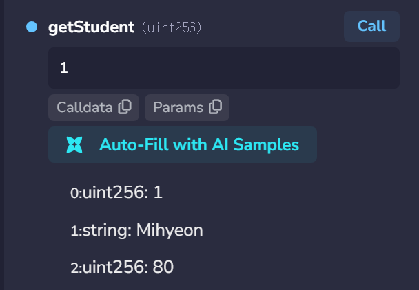
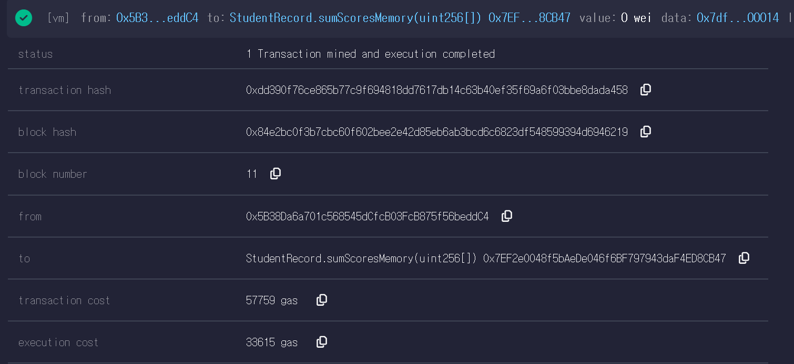
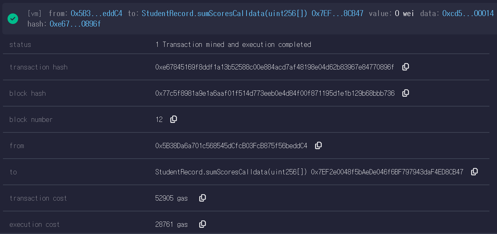

# Solidity Assignment — Memory, Storage, and Calldata

**Student:** Mihyeon Seo  
**IDE:** Remix VM · **Compiler:** Solidity 0.8.34  
**Test conditions:** Set 1 (80 → 95, 20 array elements)

I used Remix IDE to test how `memory`, `storage`, and `calldata` work in Solidity. This repository contains my contract code, experiment results, and screenshots.

## Contents

- [REPORT.md](REPORT.md) — my report with predictions, results, and answers to the seven questions
- [StudentRecord.sol](StudentRecord.sol) — the six required contract functions
- [CalldataExperiment.sol](CalldataExperiment.sol) — code for Experiment B
- [screenshots/](screenshots/) — screenshots from my Remix experiments

**Note:** I used Set 1 because the assignment did not say which student should use each set.

## Results at a glance

| Experiment | Observed result |
|---|---|
| **A — memory/storage** | Memory update returned 95 while storage remained 80; storage update changed the stored value to 95 |
| **B — calldata** | Direct mutation failed with `TypeError: Calldata arrays are read-only.`; modifying a memory copy returned 100 |
| **C — gas** | Memory: **57,759 gas**; calldata: **52,905 gas** (difference **4,854 gas**, ≈8.4%) |

## Remix experiment screenshots

Below are the screenshots I saved while running the experiments in Remix.

### Setup — deployment and initial student


### Experiment A — memory vs. storage

**Memory function returned 95:**


**The saved score was still 80:**



**After the storage update, the saved score became 95:**


### Experiment B — calldata read-only

**Changing a calldata element caused a compiler error:**

```solidity
numbers[0] = 100; // TypeError: Calldata arrays are read-only.
```


**Copying calldata to memory worked:**


![testCalldata on [10,20,30] returns 100](screenshots/07-calldata-memory-result.png)

### Experiment C — gas comparison

**sumScoresMemory: transaction cost 57,759 gas; execution cost 33,615 gas**



**sumScoresCalldata: transaction cost 52,905 gas; execution cost 28,761 gas**



## How to reproduce

1. Open [Remix IDE](https://remix.ethereum.org/) and load `StudentRecord.sol`.
2. Compile with a Solidity compiler compatible with `^0.8.20` and deploy to **Remix VM**.
3. Experiment A: register `(1, "Mihyeon", 80)`; call the memory and storage update functions with `95` and check using `getStudent(1)`.
4. Experiment B: try the intentionally invalid assignment shown above, then compile `CalldataExperiment.sol` and call `testCalldata([10,20,30])`.
5. Experiment C: invoke both summation functions with `[1,2,...,20]` and compare the transaction logs' gas figures.

For the explanations and answers to the seven questions, see [REPORT.md](REPORT.md).
