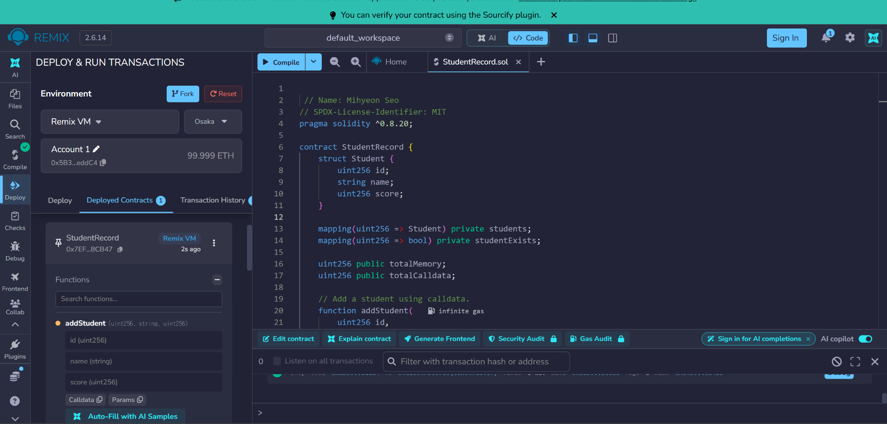
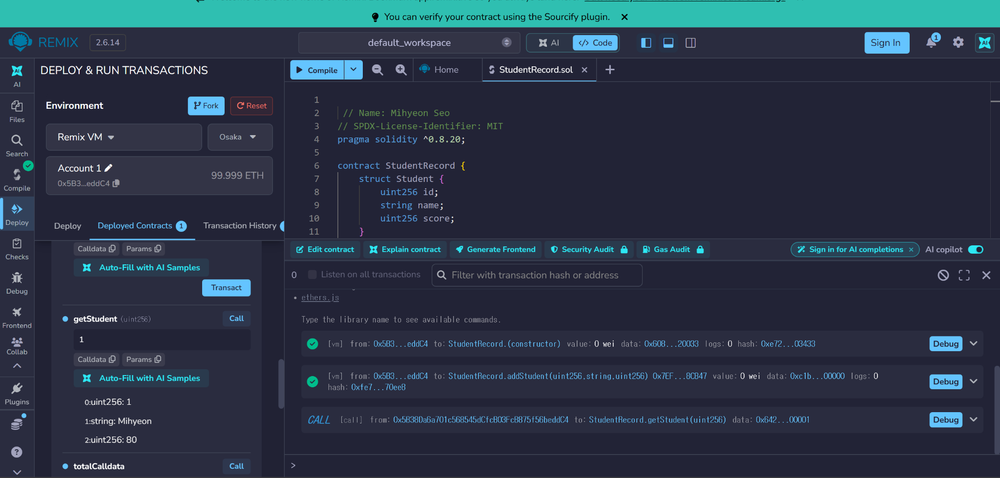
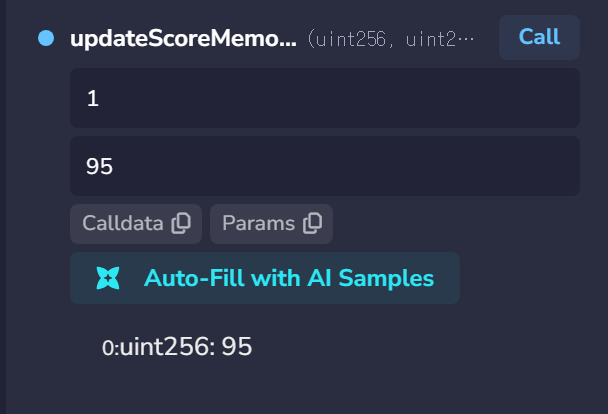
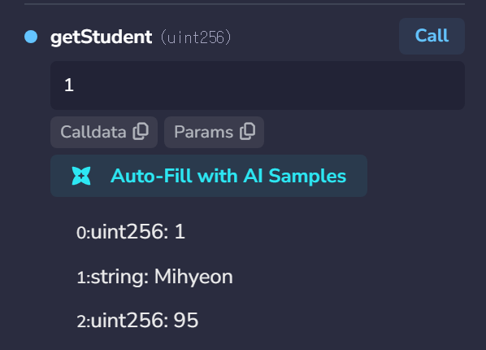
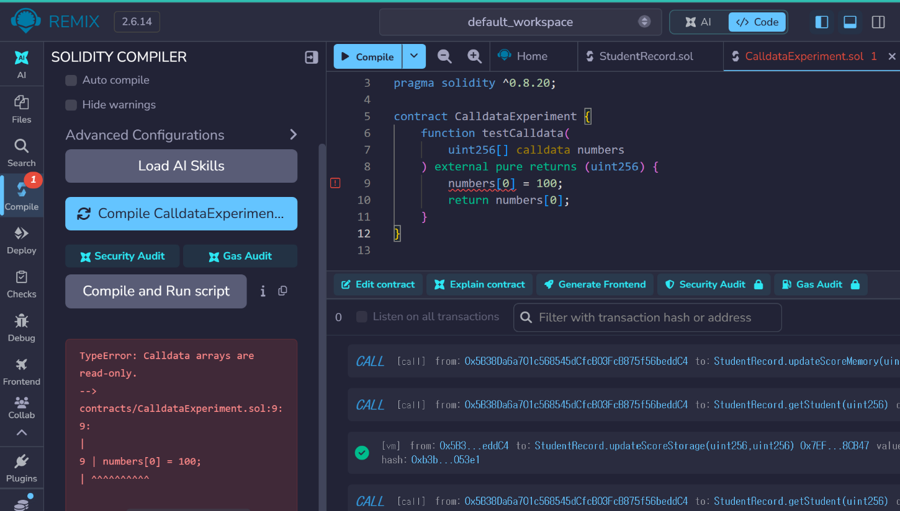
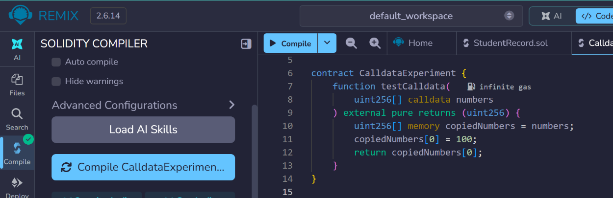

# Solidity Assignment — Memory, Storage, and Calldata

**Student:** Mihyeon Seo  
**IDE:** Remix VM · **Compiler:** Solidity 0.8.34  
**Test conditions:** Set 1 (80 → 95, 20 array elements)

This repository contains a Student Record smart contract, three Solidity data-location experiments, and the documented results for the assignment.

## Contents

- [REPORT.md](REPORT.md) — experimental predictions, observations, explanations, and answers to the seven conceptual questions
- [StudentRecord.sol](StudentRecord.sol) — the six required contract functions
- [CalldataExperiment.sol](CalldataExperiment.sol) — compiling version of the read-only calldata experiment
- [screenshots/](screenshots/) — original Remix experiment evidence (full-browser screenshots cropped to remove tabs, address bar, and bookmarks)

**Note:** I used Set 1 because the assignment handout does not specify how Sets 1–5 are assigned to individual students.

## Results at a glance

| Experiment | Observed result |
|---|---|
| **A — memory/storage** | Memory update returned 95 while storage remained 80; storage update changed the stored value to 95 |
| **B — calldata** | Direct mutation failed with `TypeError: Calldata arrays are read-only.`; modifying a memory copy returned 100 |
| **C — gas** | Memory: **57,759 gas**; calldata: **52,905 gas** (difference **4,854 gas**, ≈8.4%) |

## Remix experiment screenshots

The images are referenced as relative repository files so that they display inline on GitHub.

### Setup — deployment and initial student





### Experiment A — memory vs. storage

**The memory update returns 95:**



**The original score remains 80:**


**The storage update changes the original score to 95:**



### Experiment B — calldata read-only

**Trying to write to calldata raises a compiler error:**

```solidity
numbers[0] = 100; // TypeError: Calldata arrays are read-only.
```



**Copying calldata to memory compiles and works:**



![testCalldata on [10,20,30] returns 100](screenshots/07-calldata-memory-result.png)

### Experiment C — gas comparison

**sumScoresMemory: transaction cost 57,759 gas; execution cost 33,615 gas**


**sumScoresCalldata: transaction cost 52,905 gas; execution cost 28,761 gas**


## How to reproduce

1. Open [Remix IDE](https://remix.ethereum.org/) and load `StudentRecord.sol`.
2. Compile with a Solidity compiler compatible with `^0.8.20` and deploy to **Remix VM**.
3. Experiment A: register `(1, "Mihyeon", 80)`; call the memory and storage update functions with `95` and check using `getStudent(1)`.
4. Experiment B: try the intentionally invalid assignment shown above, then compile `CalldataExperiment.sol` and call `testCalldata([10,20,30])`.
5. Experiment C: invoke both summation functions with `[1,2,...,20]` and compare the transaction logs' gas figures.

See the [Markdown report](REPORT.md) for full interpretation and question answers.
